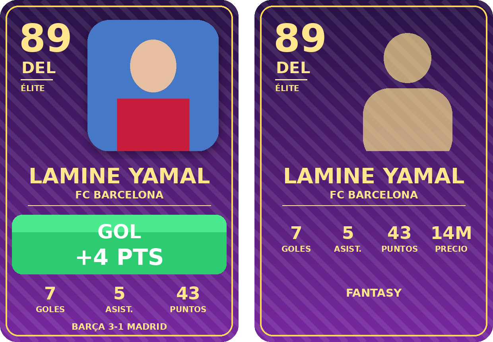

# Transfers-Joga · Bot de Fantasy Fútbol para Discord

Bot de fantasy fútbol con **cartas de jugador**. Cada gol, asistencia, tarjeta, etc. publica una carta con los puntos ganados y reparte los puntos a todos los equipos fantasy que tengan a ese jugador (el capitán puntúa x2).



## Instalación

1. Crea una aplicación en <https://discord.com/developers/applications> → **Bot** → *Reset Token* y copia el token.
2. Invita el bot a tu servidor: **OAuth2 → URL Generator** → marca `bot` y `applications.commands`, y en permisos `Send Messages`, `Embed Links`, `Attach Files`.
3. En tu ordenador:

```bash
pip install -r requirements.txt
cp .env.example .env   # y pon tu DISCORD_TOKEN (y opcionalmente GUILD_ID)
python bot.py
```

> Con `GUILD_ID` los comandos aparecen al instante en ese servidor; sin él, Discord puede tardar hasta 1 h en mostrarlos.

Los datos se guardan en `data/fantasy.db` (SQLite) y las fotos en `data/photos/`.

## Comandos

### Admin (requieren permiso *Gestionar servidor*)
| Comando | Qué hace |
|---|---|
| `/jugador_crear` | Añade un jugador: nombre, posición, club, valoración (40-99), precio y foto opcional |
| `/jugador_foto` | Cambia la foto de un jugador |
| `/jugador_borrar` | Elimina un jugador |
| `/gol` | Registra gol(es) y publica la carta |
| `/asistencia` | Registra asistencia(s) y publica la carta |
| `/evento` | Cualquier evento: portería a cero, penalti parado, MVP, partido jugado, amarilla, roja, autogol, penalti fallado |
| `/anular_evento` | Deshace un evento (el ID sale en el pie de la carta) |

### Para todos
| Comando | Qué hace |
|---|---|
| `/crear_equipo` | Crea tu equipo fantasy (100M de presupuesto) |
| `/mercado` | Lista de jugadores |
| `/fichar` / `/vender` | Ficha o vende jugadores (máx. 11) |
| `/capitan` | Elige capitán (puntos x2) |
| `/equipo` | Ver tu equipo o el de otro |
| `/clasificacion` | Tabla de la liga |
| `/carta` | Ver la carta de un jugador |
| `/puntos` | Sistema de puntuación |
| `/ultimos_eventos` | Últimos eventos |

## Puntuación

| Evento | Puntos |
|---|---|
| Gol | POR +10 · DEF +6 · MED +5 · DEL +4 |
| Asistencia | +3 |
| Portería a cero | POR/DEF +4 · MED +1 |
| Penalti parado | +5 |
| MVP | +3 |
| Partido jugado | +2 |
| Amarilla | −1 |
| Roja | −3 |
| Autogol | −2 |
| Penalti fallado | −2 |

Se cambia todo en `fantasy/scoring.py` (puntos, colores de los banners, presupuesto, tamaño de plantilla y multiplicador del capitán).

## Cartas

El color depende de la valoración: **Élite** (85+), **Oro** (75+), **Plata** (65+) y **Bronce**. Sin foto se dibuja una silueta.
Fuente: DejaVu Sans (incluida en `assets/fonts`, ver su licencia).
